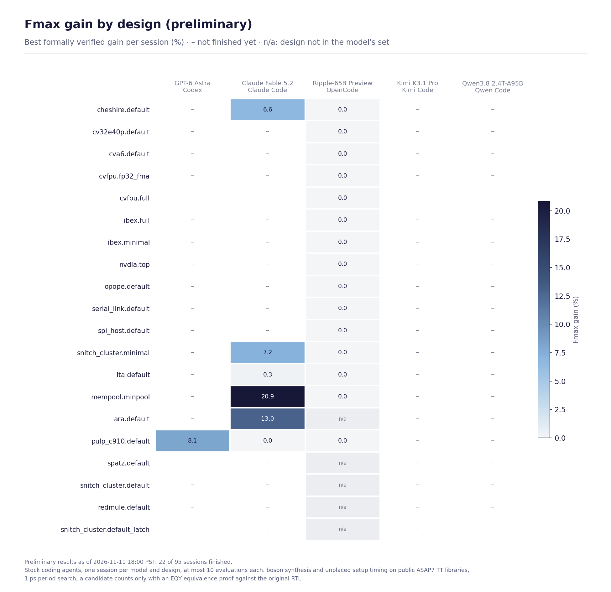

# RTL Fmax agent benchmark

**Preliminary results, updated as sessions finish.**

How far can a stock coding agent raise the maximum clock frequency (Fmax) of real RTL while keeping it
formally equivalent to the original? Each model runs in its own family's official coding CLI (or OpenCode),
with that CLI's own prompt, tools and context management, for one continuous session per design on
[20 open-source designs](docs/benchmarks.md), most of them from the ETH Zurich PULP platform. The agent may
edit only the design's `sources.sv`. It can synthesize and time its RTL with boson, Partcl's
GPU-accelerated EDA tool for synthesis and static timing, and simulate and check equivalence with Verilator
and EQY. Each session has at most 10 candidate evaluations through `./evaluate`: boson synthesis and
unplaced setup timing on the public ASAP7 TT libraries with a 1 ps period search, then an EQY equivalence
proof against the original RTL. A session's score is baseline period / best accepted period; a candidate is
accepted only when it is proven equivalent and faster than the session's best so far.

> **The ranking is provisional.** Sessions finish at different times, so models have so far finished
> different designs. A model's aggregate covers only its own finished designs, and the order below becomes
> a like-for-like ranking only once every model covers the same designs. There is one session per model
> and design, so there are no confidence intervals.

## Results

<!-- results:start -->
**Status:** 22 of 95 sessions finished (5 models, 20 designs), as of 2026-11-11 18:00 PST.

### Coverage

| Model | Developer | Harness | Access | Sessions finished |
|---|---|---|---|---:|
| Claude Fable 5.2 | Anthropic | Claude Code 2.1.322 | Official CLI signed in to a subscription | 6 / 20 |
| GPT-6 Astra | OpenAI | Codex 0.154.0 | Official CLI signed in to a subscription | 1 / 20 |
| Kimi K3.1 Pro | Moonshot AI | Kimi Code 2.5.2 | OpenRouter, pinned to Moonshot AI's own endpoint (MXFP4), fallbacks disabled | 0 / 20 |
| Qwen3.8 2.4T-A95B | Qwen (Alibaba) | Qwen Code 0.27.1 | OpenRouter, one pinned provider (SiliconFlow, FP8) | 0 / 20 |
| Ripple-65B Preview | Ricursive AI | OpenCode 1.19.5 | Self-hosted (SGLang 0.5.19, BF16) for its first 15 designs; OpenRouter pinned to PrimeIntellect (BF16) for later sessions | 15 / 15 |

### Results by model

| Model | Harness | Designs finished | Fmax gain (geomean) | Designs improved | Mean evaluations | Candidates not proven |
|---|---|---:|---:|---:|---:|---:|
| GPT-6 Astra | Codex | 1 / 20 | +8.06% | 1 / 1 | 10.0 | 70% (7 / 10) |
| Claude Fable 5.2 | Claude Code | 6 / 20 | +7.76% | 5 / 6 | 5.0 | 43% (13 / 30) |
| Ripple-65B Preview | OpenCode | 15 / 15 | +0.00% | 0 / 15 | 0.2 | 100% (3 / 3) |

Fmax gain is the geometric mean of each finished session's Fmax ratio (baseline period / best accepted period) over the designs that model has finished. Models have finished different designs, so this order is provisional, not a like-for-like ranking, until every model covers the same designs. "Candidates not proven" is the share of evaluations whose equivalence proof did not pass.

### Best result by design

| Design | Baseline period (ns) | Sessions finished | Best period (ns) | Fmax gain | Best by |
|---|---:|---:|---:|---:|---|
| `cheshire.default` | 1.047 | 2 | 0.982 | +6.62% | Claude Fable 5.2 |
| `cv32e40p.default` | 0.657 | 1 | 0.657 | +0.00% | no improvement yet |
| `cva6.default` | 1.038 | 1 | 1.038 | +0.00% | no improvement yet |
| `cvfpu.fp32_fma` | 1.401 | 1 | 1.401 | +0.00% | no improvement yet |
| `cvfpu.full` | 2.114 | 1 | 2.114 | +0.00% | no improvement yet |
| `ibex.full` | 0.935 | 1 | 0.935 | +0.00% | no improvement yet |
| `ibex.minimal` | 0.716 | 1 | 0.716 | +0.00% | no improvement yet |
| `nvdla.top` | 0.789 | 1 | 0.789 | +0.00% | no improvement yet |
| `opope.default` | 0.857 | 1 | 0.857 | +0.00% | no improvement yet |
| `serial_link.default` | 0.305 | 1 | 0.305 | +0.00% | no improvement yet |
| `spi_host.default` | 0.475 | 1 | 0.475 | +0.00% | no improvement yet |
| `snitch_cluster.minimal` | 1.288 | 2 | 1.201 | +7.24% | Claude Fable 5.2 |
| `ita.default` | 0.903 | 2 | 0.900 | +0.33% | Claude Fable 5.2 |
| `mempool.minpool` | 2.869 | 2 | 2.374 | +20.85% | Claude Fable 5.2 |
| `ara.default` | 1.064 | 1 | 0.942 | +12.95% | Claude Fable 5.2 |
| `pulp_c910.default` | 1.005 | 3 | 0.930 | +8.06% | GPT-6 Astra |
| `spatz.default` | 2.266 | 0 | — | — | — |
| `snitch_cluster.default` | 2.128 | 0 | — | — | — |
| `redmule.default` | 1.636 | 0 | — | — | — |
| `snitch_cluster.default_latch` | 2.169 | 0 | — | — | — |

### Early observations

Counts over every finished session of the models above. They describe what happened; with one session per model and design they do not establish causes or rankings.

- 43 candidates evaluated: 15 accepted, 5 proven equivalent but not faster than the session's best, 23 not proven (16 with a partition EQY could not prove, 1 at the proof deadline, 6 over the proof memory budget), 0 failed to compile or measure.
- Of 22 finished sessions, 5 ended with the agent finishing on its own, 16 ran to the time budget and 1 ended with an agent error.
- Sessions used 2.0 of the 10 allowed evaluations on average; 1 used all 10.
- Largest single gain so far: `mempool.minpool` by Claude Fable 5.2, 2.869 ns to 2.374 ns (+20.85% Fmax).
- No finished session has improved `cv32e40p.default`, `cva6.default`, `cvfpu.fp32_fma`, `cvfpu.full`, `ibex.full`, `ibex.minimal`, `nvdla.top`, `opope.default`, `serial_link.default`, `spi_host.default` yet.
<!-- results:end -->

## Charts

Vector versions: [model-fmax.svg](charts/model-fmax.svg), [design-fmax.svg](charts/design-fmax.svg).
The charts are rendered from `results/` by [charts/generate.py](charts/generate.py).

## Documentation and data

- [docs/methodology.md](docs/methodology.md): sessions and evaluations, the exact prompt and `TASK.md`,
  acceptance, budgets, the agent environment, controls, rerun rules, models and harnesses, limitations.
- [docs/benchmarks.md](docs/benchmarks.md): the 20 designs, their origin, baselines and session budgets.
- [results/](results/): `sessions.csv` (one row per model and design), `evaluations.csv` (one row per
  candidate evaluation), `summary.json` (per-model aggregates) and `models.json` (models and harnesses).
  The column definitions are in the methodology.
- The results section above is generated from `results/` by
  [scripts/render_readme.py](scripts/render_readme.py).

## License

Copyright 2026 Partcl. The code in this repository (`charts/generate.py` and `scripts/`) is licensed under
the [Apache License 2.0](LICENSE). The data (`results/`), the charts and the documentation, including this
README, are licensed under [Creative Commons Attribution 4.0 International](LICENSE-CC-BY-4.0).
